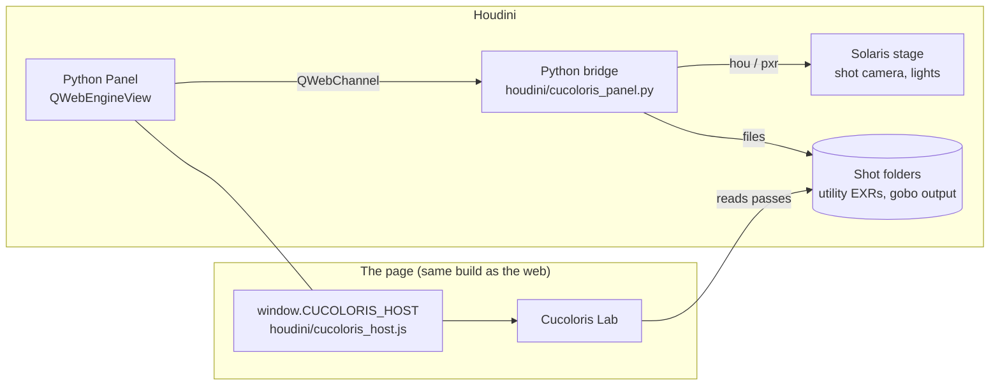

# Cucoloris Lab in Houdini: a guide for TDs

**The goal.** A lighter picks a shot, makes a gobo for it in Cucoloris Lab (water caustics, tree dapple, window light, soft shapes), and with one click gets:

1. the gobo image or image sequence written into the shot,
2. a light placed in the shot, with that gobo attached.

**The rule.** There is one codebase. The web version (GitHub Pages, the Claude artifact) and the production tool are the same built page. Production adds one small object, `window.CUCOLORIS_HOST`, that connects the page to Houdini and the pipeline. Nothing else forks, so the two versions cannot drift apart. `tests/golden.py` proves they still match (see [Keeping web and production matched](#keeping-web-and-production-matched)).

What is done and tested in the web version:

- the host seam,
- the shot-space light rig and its USD layer,
- the settings file,
- the export writers (EXR, Ptex, TIFF, PNG, JPEG),
- a scripting API,
- golden-frame tests.

The files under `houdini/` are a **starting point that has not been run inside Houdini**. Parameter and node names marked *check* must be confirmed against your Houdini version.

---

## Contents

1. [How it runs](#how-it-runs)
2. [What a TD has to build](#what-a-td-has-to-build-the-checklist)
3. [The host contract](#the-host-contract-windowcucoloris_host)
4. [Utility passes and the camera](#utility-passes-and-the-camera)
5. [What an export writes](#what-an-export-writes)
6. [The light rig and its USD layer](#the-light-rig-and-its-usd-layer)
7. [How the gobo is projected (the exact maths)](#how-the-gobo-is-projected)
8. [Hooking the gobo to your renderer](#hooking-the-gobo-to-your-renderer)
9. [The settings file](#the-settings-file)
10. [Scripting API](#scripting-api-windowcucoloris)
11. [Keeping web and production matched](#keeping-web-and-production-matched)
12. [Source layout and building](#source-layout-and-building)
13. [Known limits and things to verify](#known-limits-and-things-to-verify)

---

## How it runs



- **The tool keeps its own viewer, timeline and GPU context.** The Scene view never touches Houdini geometry. It rebuilds the shot from the shot's *utility passes* (world position, normals, optional surface colour), so its speed depends on image resolution, not set complexity. Houdini's viewport and timeline can stay idle while the lighter scrubs gobo animation.
- **Two ways to host it, both using the same page:**
  - **A. Python Panel (recommended to try first).** A `QWebEngineView` docked in a Houdini pane loads the built page. `houdini/cucoloris_panel.py` is the starting point.
  - **B. A separate window.** The page runs in Chrome or a small Electron or Qt app and talks to Houdini over a local socket (for example Houdini's `hrpyc` or a small websocket server). Use this if the embedded browser can't give full WebGL2 on your machines. Only the transport inside `cucoloris_host.js` changes.
- **Houdini is only involved at the edges:**
  - listing shots,
  - pointing at their passes and camera,
  - writing files,
  - building the light.

---

## What a TD has to build (the checklist)

| # | Task | Where | Web version today |
|---|------|-------|-------------------|
| 1 | Load the built page in a Houdini Python Panel and confirm WebGL2 + `EXT_color_buffer_float` work there | `houdini/cucoloris_panel.py`, `houdini/cucoloris.pypanel` | Browser |
| 2 | Inject Qt's `qwebchannel.js` and `houdini/cucoloris_host.js` before the page script | same | — |
| 3 | **`shots()`**: list the show's sequences and shots (id, seq, shot, frame range) | `Bridge.shots` | Two placeholder shots |
| 4 | **`shotPasses()`**: for a shot, the utility EXR paths per frame, the layer names for P / N / albedo, scene units and up axis | `Bridge.shot_passes` | Placeholder passes rendered on the fly |
| 5 | **`shotCamera()`**: the shot camera per frame (world matrix + vertical FOV) | `Bridge.shot_camera` (reads the USD camera) | The placeholder knows its camera; without one the tool solves the camera from the P pass |
| 6 | **`exportDir`**: where a shot's gobos go (a path template) | `Bridge.config` | Downloads / a zip |
| 7 | **`writeFile()`**: write the frames, the light rig and the settings file | `Bridge.write_file` | Downloads / a zip / a folder the user picks |
| 8 | **`sendLight()`**: bring the light rig into the shot (a Sublayer/Reference LOP of the `.light.usda`) and **attach the gobo** with your renderer's projection light filter | `Bridge.send_light` → `attach_gobo()` | The rig ships inside the zip |
| 9 | Optional: **`frameChanged()`** so Houdini's frame follows the tool's timeline | `Bridge.set_frame` | — |
| 10 | Run `tests/golden.py` and `tests/rig_projection.py` against the production page on artist machines | `tests/` | Both pass in a headless browser |

Steps 1–2 and 7–8 are generic. Steps 3–6 are pipeline-specific: they encode where your studio keeps shots, passes and cameras.

---

## The host contract (`window.CUCOLORIS_HOST`)

Defined in `src/parts/host.js`. A host object is merged over the web defaults **member by member**. Anything left out keeps working as on the web. Define it **before** the page's script runs.

| Member | Signature | Web behaviour | Production |
|---|---|---|---|
| `name`, `label` | strings | `'web'`, `'Web'` | `'houdini'`, `'Houdini'` (the label appears in the UI, for example "Export & send to Houdini") |
| `shots()` | `→ Shot[]` or `Promise<Shot[]>` | the two placeholders | the pipeline's shots |
| `openShot(shot)` | `→ Source` | renders placeholder passes | `cucoloris.exrSource(...)` over the shot's utility EXRs |
| `writeFile(path, blob)` | `→ Promise<string>` (the path written) | `null`: the dialog zips or downloads | write to disk |
| `exportDir(ctx)` | `({shot, mode, name}) → string`, synchronous | `''` | e.g. `/shows/X/seq/shot/lighting/gobos/<name>` |
| `sendLight(rig, files)` | `→ Promise` | `null`: the option is hidden | build or update the light |
| `frameChanged(n)` | `(frameNumber) → void` | `null` | `hou.setFrame(n)` if the lighter wants Houdini to follow |

**Shot** entries are `{id, seq, shot, label, first, last}`. These optional fields seed the tool's set-up for that shot:

- `mode`: the starting pattern.
- `preset`: `{mode, name, v}`.
- `lights`: a starting light per pattern.
- `anchors`: where a window or hull sits.
- `placeholder: true` marks mock shots only.

**Source** objects look like `{units, upZ, read(frame, step), camera?(frame)}`:

- `units`: metres per scene unit. `0` makes the tool guess from the passes; always give it in production.
- `upZ`: `true` for a Z-up scene.
- `read(frame, step)`: returns `{pos, nrm?, col?, a?, matte?}`. Each pass is `{W, H, data: [Float32Array per channel]}`, rows top to bottom. `step` = 1, 2 or 4 skips pixels for the Model detail setting.
- `camera(frame)`: returns `{matrix, vfov}`. `matrix` is the camera's 4×4 local-to-world matrix, row-major with row vectors (USD/Houdini convention, camera looking down −Z, in scene units). `vfov` is the vertical field of view in degrees. `{eye, at | forward, up, vfov}` also works. Without `camera` the tool solves one from the position pass (a DLT, good to a pixel or so). With it, the tool uses the pipeline's camera exactly.

`cucoloris.exrSource(filesByFrame, layers, opts)` builds a Source from utility EXRs:

- `filesByFrame`: a `Map` from frame number to an array of objects with `arrayBuffer()` (a `File`, a fetch `Response`, or the file refs in `cucoloris_host.js`).
- `layers`: the EXR layer names, `{pos: 'P', nrm: 'N', col: 'albedo'}` (match your AOV names).
- `opts`: `{units, upZ, camera}`.

The reader handles scanline single-part and multi-part EXRs with no compression, RLE, ZIPS or ZIP. **Ask for P, N and albedo in one of those** (not PIZ or DWA). Normals are read if present, otherwise derived from P. Albedo is optional and only colours the preview.

---

## Utility passes and the camera

- **P** must be **world-space position**, in the same space and units as the camera. Pixels with no geometry should be 0 or have alpha 0. **N** is world-space normals.
- Rows are top to bottom, as an EXR stores them. Any resolution works; the tool downsamples for speed (Model detail).
- Pixels where P blends two surfaces (anti-aliased edges) are dropped automatically.
- A *matte* (optional) marks pixels that receive light but should not cast shadows, such as water surfaces. It gives P.w = 0.75 internally.
- The tool works internally in **metres, Y up**. It converts the shot on the way in (`units`, `upZ`) and converts back on the way out: the light rig is written in the **shot's own units and up axis**. This is tested by `tests/rig_projection.py`: the uv computed from the exported USD alone matches the tool's to ~1e-6, including for a Z-up centimetre scene handed over through a test host.
- Overscan or a mismatched aperture: if the passes were rendered with overscan, give the camera's vfov for the *rendered* image, not the delivery frame.

---

## What an export writes

The Export dialog (or `cucoloris.exportFrames(opts)`) writes:

| File | What |
|---|---|
| `<name>.<####>.<ext>` | The final gobo (after Levels and Paint over) per frame. Formats: OpenEXR (half/float, ZIP), **Ptex** (8/16-bit, half, float; one quad face with mipmaps; validated with Disney's Ptex library), TIFF (8/16-bit, 32-bit float), PNG (8/16-bit), JPEG. 512–4096 px square. |
| `<name>.light.usda` | The light rig (below). Only with "Gobo + light rig". |
| `<name>.cucoloris.json` | The settings file (below). Only with "Gobo + light rig", or from "Save settings…". |

- **Frame numbers:** in a multi-frame shot, files use the shot's own frame numbers. Otherwise the first timeline frame is written as *First file number* (1001 by default).
- **Colour:** float formats hold **linear transmission** (0–1). For 8/16-bit formats the lighter chooses:
  - **sRGB** (default): a renderer reading the file as sRGB gets the linear values back.
  - **Linear**: tell the renderer the file is raw.
- **Orientation:** image top is the light's +Y (up), image right is +X. Ptex stores v = 0 at the bottom.
- **Where files go:** on the web, a single file downloads directly and anything more travels in a zip (inside the Claude artifact only PNG, JPEG, JSON and zip can be handed over). With a host `writeFile`, everything goes to `exportDir`.

---

## The light rig and its USD layer

`lightRig()` (in `src/parts/rig.js`) describes the scene light **in shot space**. `rigUSDA()` writes the same as a USD layer. Both carry `version: 1` (`rigVersion` in USD `customData`).

```
#usda 1.0
( defaultPrim = "cucoloris"  metersPerUnit = …  upAxis = "Y"|"Z"  startTimeCode/endTimeCode = the frame range  framesPerSecond = … )
def Xform "cucoloris" {
    def SphereLight "gobo_light" ( prepend apiSchemas = ["ShapingAPI"] )   # a spotlight
    # or: def DistantLight "gobo_light"                                       # the sun
    {
        float inputs:intensity = 1
        float inputs:exposure = <EV>
        color3f inputs:color = <linear>
        float inputs:radius = 0.04 m in scene units            # spot only
        float inputs:shaping:cone:angle = <half angle>         # spot only (square beams open to the corners)
        float inputs:shaping:cone:softness = <0..1>            # spot only
        float inputs:angle = 0.53                               # sun only (the sun's disc)
        matrix4d xformOp:transform = …                          # light shines down -Z, +Y is the gobo's up

        custom asset  cucoloris:gobo:file = @first frame@
        custom asset  cucoloris:gobo:file.timeSamples = { 1001: @…1001.exr@, … }   # sequences
        custom string cucoloris:gobo:filePattern = "name.$F4.exr"
        custom string cucoloris:gobo:fileHashPattern = "name.####.exr"
        custom int2   cucoloris:gobo:frameRange
        custom token  cucoloris:gobo:colorSpace = "linear" | "sRGB"
        custom token  cucoloris:gobo:projection = "perspective" | "orthographic"
        custom float  cucoloris:gobo:fov, cucoloris:gobo:tiling        # perspective
        custom float  cucoloris:gobo:width; point3d cucoloris:gobo:center   # orthographic
        custom token  cucoloris:gobo:wrap = "repeat" | "black" | "white" | "repeat-u"
        custom float  cucoloris:gobo:blur                               # fraction of image width
        custom token  cucoloris:beamShape = "round" | "square"          # spot only
        custom point3d cucoloris:aim
        custom float  cucoloris:irradianceAtAim
        custom string cucoloris:mode
        custom asset  cucoloris:settings = @name.cucoloris.json@
    }
}
```

- **Why custom attributes.** UsdLux has no standard gobo. The gobo is described renderer-neutrally in `cucoloris:*` attributes, and `attach_gobo()` turns it into your renderer's light filter. The plain UsdLux part (position, orientation, cone, colour, exposure) works as-is in any USD renderer: the light will be in the right place, pointing the right way, before the gobo is hooked up.
- **Paths:** web exports use paths relative to the `.usda` (`./name.1001.exr`; all files sit together). A host's `writeFile` returns absolute paths and the rig uses those.
- **Sequences:** `cucoloris:gobo:file` is time-sampled per frame (USD's way to animate an asset path). `filePattern` gives the `$F4` form for Houdini parameters.
- **Intensity:** `exposure` is the tool's EV. `irradianceAtAim` is the irradiance the tool's preview gives on a surface facing the light: 2^EV × 25 / d² for a spot at distance d m, 2^EV for the sun. Treat the absolute level as a lookdev calibration per renderer. The *relative* values between lights and shots are consistent.
- **Validated** by `tests/rig_projection.py`: the USD opens in `pxr` 0.26. For 200 random points per case the gobo uv computed from the USD alone matches the tool's own projection to ~1e-6. This covers spot and sun, stand-in sets, both placeholder shots, and a Z-up centimetre host.

---

## How the gobo is projected

This is exactly what the tool's shaders do (`src/parts/scene.js` → `goboProjection()`, `lightAt()`). A renderer filter that does the same will match the preview.

Light space (from the USD matrix rows): **X** = right, **Y** = up, **Z** = back. The light shines along −Z. Let `p` be a shaded point, `o` the light position, and `uv` the gobo coordinate (0–1, v up).

**Spot (perspective):**

```
d   = p - o
x   = dot(d, X);   y = dot(d, Y);   z = -dot(d, Z)        # z > 0 in front of the light
t   = tan(fov / 2)
uv  = 0.5 + 0.5 * (x / z, y / z) / t * tiling
```

- The square image spans `fov` edge to edge. `tiling > 1` repeats a seamless tile inside it at its real-world size.
- Beam mask, round: `1 - smoothstep(1 - soft, 1, r)` with `r = length((x, y) / (z t))`. Square: the same per axis.
- Falloff 1/d².

**Sun (orthographic):**

```
uv = 0.5 + (dot(p - center, X), dot(p - center, Y)) / width
```

**Wrap outside 0–1:**

- `repeat`: seamless tiles.
- `black`: a framed image (window, light pool, shapes).
- `white`: a single tree element in open sun.
- `repeat-u`: hull caustics tile sideways and are black above and below.

**Blur:** a disc blur of radius `blur × image width` (× `tiling` for spots).

---

## Hooking the gobo to your renderer

This is the one renderer-specific step (`attach_gobo()` in `houdini/cucoloris_panel.py`). Use your renderer's **projected-texture light filter**, often called a gobo, cookie or projector, and drive it from the attributes above:

| Rig attribute | Typical filter control |
|---|---|
| `cucoloris:gobo:file` / `filePattern` | texture map (use the `$F4` pattern for sequences) |
| `cucoloris:gobo:colorSpace` | texture colour space (linear / sRGB) |
| `cucoloris:gobo:projection`, `fov`, `tiling` | perspective projection; the image fills `fov`, repeated `tiling` times (spot) |
| `cucoloris:gobo:width`, `center` | orthographic projection, `width` scene units across (sun) |
| `cucoloris:gobo:wrap` | wrap / tile mode outside the image |
| `cucoloris:gobo:blur` | filter blur, if the filter has one (or pre-blur the frames) |
| light transform | the filter's placement: usually inherits the light's transform; image +Y = light +Y |

Notes. None of these were tested inside the renderers, so verify against your renderer and Houdini versions:

- **Karma:** use Karma's light filter for projected textures if your Houdini version has one. Otherwise use a light-filter shader that does the uv maths above. The maths is short and works for spot and sun.
- **RenderMan:** the cookie light filter (PxrCookieLightFilter) projects a map in perspective or orthographic.
- **Arnold:** the gobo filter works on spot lights. For a distant (sun) light, use a perspective spot placed far away or a projection shader.
- **Any renderer** where the filter's projection doesn't fit: put the gobo on a card in front of a light instead. This is the classic cucoloris; the card sits at distance `z` and is `2 · z · tan(fov/2)` wide. This is renderer-agnostic and matches the perspective formula exactly.

`attach_gobo()` should be **idempotent**: called again for the same shot and mode, it updates the existing filter instead of adding another.

---

## The settings file

`<name>.cucoloris.json` (`schema: "cucoloris.settings"`, `version: 1`) holds everything needed to make the same gobo again:

- the pattern parameters,
- Levels,
- the timeline (length, loop, shutter),
- the scene light (in tool space),
- the shot id,
- the paint layers (as PNG data URLs),
- the export settings.

It opens in any copy of the tool ("Open settings…" or `cucoloris.applySettings(json)`). It is the right thing to keep in the shot for re-renders on the farm with a headless browser. **Version rule:** a newer tool reads older files; a file newer than the tool is refused with a message.

---

## Scripting API (`window.cucoloris`)

The same calls the panel makes, for the host, farm scripts and tests (`src/parts/api.js`):

| Call | |
|---|---|
| `modes()`, `getMode()`, `setMode(m)` | patterns: `under`, `over`, `hull`, `trees`, `windows`, `shapes` |
| `shots()`, `selectShot(id)`, `shotReady()` | `''` = the stand-in sets |
| `getFrame()`, `setFrame(n)` | frame numbers as the export writes them |
| `getSettings()`, `applySettings(obj)` | the settings file |
| `lightRig(info?)`, `lightRigUSDA(info?)` | the light as it stands |
| `renderFrame(n, res, {quality, channels})` | `{w, h, nch, data}`: linear Float32, rows top to bottom |
| `exportFrames(opts, onProgress)` | any export dialog setting: `{fmt, depth, res, range: 'current'/'range'/'all', from, to, first, chans, enc, qual, name, rig: 'on', send: 'on'}` |
| `encode(img, {fmt, depth, enc})` | the encoders, to `Blob` |
| `exrSource(filesByFrame, layers, opts)` | for `openShot` |

---

## Keeping web and production matched

- **One build, two hosts.** Production loads `dist/cucoloris-lab.html` (or `index.html`), the same file the web serves. Pipeline code lives only in the host shim and the Python bridge.
- **Golden frames.** `tests/golden.py` renders every pattern at fixed frames, plus a placeholder shot, from stored settings files. It compares the images (mean / 99th-percentile error) and the **light rig** (positions, matrices, fov to 1e-4) against `tests/golden/ref/`. Run it:
  - in CI on every change,
  - on artist machines with the production page (`--page`),
  - after any Chrome or Qt update.

  ```
  python3 tests/golden.py                 # compare
  python3 tests/golden.py --update        # after an intended change; commit the new refs with it
  python3 tests/golden.py --software      # machines without a GPU (SwiftShader)
  ```

- **Versions.** `rigVersion`, `settingsVersion` and the saved-state version (`ver` in `src/app.js`) change only with a migration. Add the migration next to the existing ones in `src/app.js` (look for `saved.ver`) and in `applySettings()`.

---

## Source layout and building

```
build.py              python3 build.py → dist/cucoloris-lab.html (the artifact / panel page) and index.html (GitHub Pages)
src/page.html         markup and styles
src/app.js            the application; /*@@PART name@@*/ pulls in src/parts/name.js
src/parts/
  host.js             THE SEAM: the web host and the CUCOLORIS_HOST merge
  shot.js             shots: reading passes (exrSource, placeholders), camera from host or solved, rebuilding the scene
  scene.js            scene preview, the light (sceneLight) and goboProjection()
  rig.js              light rig, USD layer, settings file
  export.js           export dialog, EXR / Ptex / TIFF / PNG / JPEG writers, zip
  api.js              window.cucoloris
  gizmo.js            light select / move / rotate in the Scene view
  water.js, spec2.js  water caustics (FFT spectrum, photon mesh)
  trengine.js, trshaders.js, trspecies.js   trees (growth, wind simulation, rendering)
  window.js, winmode.js                    windows
  shapes.js, shapemode.js                  soft shapes
  paint.js            paint your own / paint over
  ui.js, helpers.js, gl_program.js, glsl_*.js, exr.js, rng.js   panel, GL helpers, shader common code, EXR reader
houdini/              starting point for the Houdini host (not yet run in Houdini)
tests/golden.py       golden frames + light rig against stored references
tests/rig_projection.py   the exported USD light lands the gobo exactly where the preview does
```

Everything is plain JavaScript and GLSL in one page: no bundler, no npm, no network access at run time.

---

## Known limits and things to verify

- **WebGL in QtWebEngine.** The tool needs WebGL2 with float render targets (`EXT_color_buffer_float`). Check this first in Houdini's embedded browser on your OS and GPU (open the panel; an error banner appears if float targets are missing). You may need `QTWEBENGINE_CHROMIUM_FLAGS="--ignore-gpu-blocklist"` in `houdini.env`. If the embedded browser can't do it, use the separate-window route (B).
- **PySide version.** Houdini 20.x ships PySide2 (Qt 5); later versions move to PySide6. The panel code imports either. Confirm `QtWebEngineWidgets` is present in your build.
- **Passing big files over QWebChannel.** `writeFile` sends base64 through the channel: fine for 2K, slow for 4K float sequences. For heavy use, serve a small local HTTP endpoint from the bridge (or a `QWebEngineUrlSchemeHandler`) and POST the bytes.
- **Reading passes.** The shim reads EXRs with `file://` XHR, which needs `LocalContentCanAccessFileUrls`. It falls back to the bridge's `readFile` (base64).
- **Export resolution** tops out at 4096² (GPU memory). Gobos are square.
- **Placeholders.** The web version's shots, their camera and the units guess are mockups. In production, `shots`, `shotPasses` and `shotCamera` replace them. Nothing else changes.
- **Per-browser state.** The web version keeps the lighter's last settings in browser storage. In production the settings file in the shot is the record. Browser storage is only a convenience.
